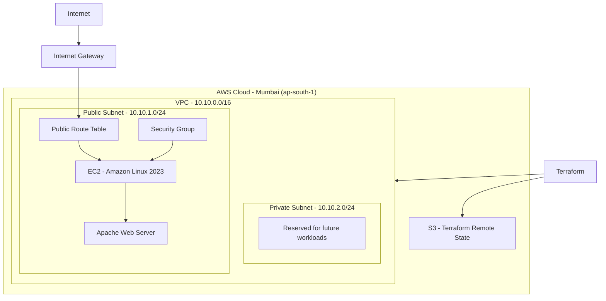

# Terraform AWS VPC and EC2 Project

In this project, I used Terraform to create AWS infrastructure from scratch. The main goal was to understand how AWS networking works, how to deploy an EC2 instance inside a VPC, and how to manage AWS resources using Infrastructure as Code.

I also worked with Git and GitHub to manage the project and explored GitHub Actions for automating Terraform workflows.

## What I Built

I created an AWS VPC with public and private subnets, configured internet connectivity, and deployed an EC2 instance in the public subnet.

The EC2 instance runs Amazon Linux 2023. Using a startup script (User Data), I installed Apache and hosted a simple web page.

I also configured an S3 bucket to store Terraform state remotely.

## Architecture




## AWS Resources

| Resource | Configuration |
|---|---|
| VPC | 10.10.0.0/16 |
| Public Subnet | 10.10.1.0/24 |
| Private Subnet | 10.10.2.0/24 |
| Availability Zone | ap-south-1a |
| Internet Gateway | Attached to VPC |
| Route Table | Default route to Internet Gateway |
| EC2 Instance | t3.micro |
| Operating System | Amazon Linux 2023 |
| Web Server | Apache |
| Remote State | Amazon S3 |

## Project Structure

```text
vpc-ec2/
│
├── .github/
│   └── workflows/
│       └── terraform.yml
│
├── .gitignore
├── backend.tf
├── versions.tf
├── network.tf
├── routing.tf
├── security.tf
├── ec2.tf
└── README.md
```

### Terraform Files

- `backend.tf` – Configures the S3 backend for remote state management.
- `versions.tf` – Defines Terraform and AWS provider versions.
- `network.tf` – Creates the VPC and subnets.
- `routing.tf` – Configures the Internet Gateway and route table.
- `security.tf` – Defines security group rules.
- `ec2.tf` – Creates the EC2 instance and installs Apache.

## Security Configuration

I configured the EC2 security group with the following inbound rules:

| Port | Protocol | Source | Purpose |
|---|---|---|---|
| 80 | TCP | 0.0.0.0/0 | Access the website |
| 22 | TCP | My public IP (/32) | SSH access |

SSH access is restricted to a specific public IP instead of allowing access from anywhere.

The Terraform state is stored in a private S3 bucket with encryption enabled and public access blocked.

## Terraform Commands

These are the commands I used while working on the project.

**Initialize Terraform**

```bash
terraform init
```

**Format Terraform files**

```bash
terraform fmt
```

**Validate the configuration**

```bash
terraform validate
```

**Check the infrastructure changes**

```bash
terraform plan
```

**Deploy AWS resources**

```bash
terraform apply
```

## GitHub Actions

I also worked on integrating GitHub Actions with AWS to automate Terraform workflows.

The intended pipeline includes:

1. Checkout the repository.
2. Authenticate with AWS using GitHub OIDC.
3. Initialize Terraform.
4. Check Terraform formatting.
5. Validate the configuration.
6. Generate an infrastructure plan.
7. Apply infrastructure changes after the required checks and approval.

Using OIDC avoids storing long-term AWS access keys in GitHub Secrets.

## What I Learned

While working on this project, I got hands-on experience with:

- Creating AWS VPCs and subnets using Terraform.
- Understanding public and private subnet configurations.
- Configuring Internet Gateways and route tables.
- Deploying EC2 instances.
- Installing and configuring Apache using User Data.
- Managing Terraform state remotely using S3.
- Configuring AWS security groups.
- Using Git and GitHub for version control.
- Learning how GitHub Actions can automate Terraform deployments.
- Understanding AWS IAM roles and OIDC authentication.

## Future Improvements

I would like to extend this project by adding:

- Application Load Balancer.
- HTTPS using AWS Certificate Manager.
- NAT Gateway for private subnet connectivity, when needed.
- CloudWatch monitoring and logging.
- Separate development and production environments.
- Terraform modules for reusable infrastructure.

## Cleanup

To remove the infrastructure created by Terraform:

```bash
terraform plan -destroy
terraform destroy
```

Review the destruction plan before confirming. The S3 remote state bucket is managed separately and should be retained until the Terraform state is no longer needed.

---

**Tools Used:** AWS | Terraform | Git | GitHub | GitHub Actions | AWS IAM | PowerShell
