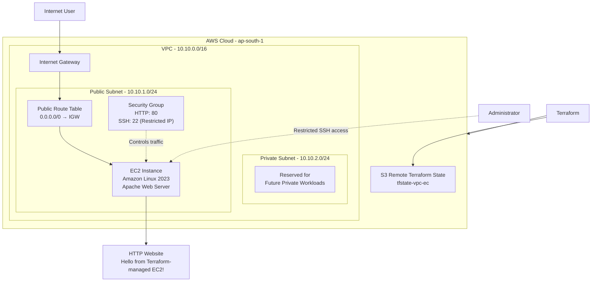
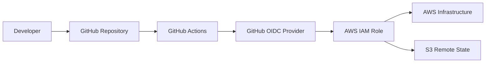

# Terraform AWS VPC and EC2 Infrastructure

A hands-on Infrastructure as Code (IaC) project that provisions AWS networking and compute resources using Terraform.

The project demonstrates how to build an AWS VPC, configure public and private subnets, establish internet connectivity, deploy an EC2 web server, and manage infrastructure through Terraform.

## Project Objectives

- Understand Infrastructure as Code using Terraform.
- Create and configure an AWS VPC.
- Build public and private subnets.
- Configure Internet Gateway and route tables.
- Deploy an EC2 instance running Amazon Linux 2023.
- Configure Security Groups to control network traffic.
- Host a basic Apache web server on EC2.
- Store Terraform state remotely using Amazon S3.
- Practice Git version control and infrastructure automation.
- Learn secure AWS authentication and GitHub Actions OIDC integration.

## Architecture Diagram!
[Uploading image.png…]()




## AWS Resources Created

| AWS Service | Configuration | Purpose |
|---|---|---|
| Amazon VPC | 10.10.0.0/16 | Isolated network |
| Public Subnet | 10.10.1.0/24 | Hosts EC2 instance |
| Private Subnet | 10.10.2.0/24 | Reserved for private workloads |
| Internet Gateway | Attached to VPC | Internet connectivity |
| Route Table | 0.0.0.0/0 via IGW | Public internet routing |
| Security Group | HTTP 80, SSH 22 restricted | Network traffic control |
| EC2 | t3.micro | Web server |
| Amazon Linux 2023 | EC2 operating system | Server operating system |
| Apache HTTP Server | Port 80 | Serves website |
| Amazon S3 | Remote state bucket | Terraform state storage |

## Project Structure

```text
vpc-ec2/
│
├── .github/
│   └── workflows/
│       └── terraform.yml
│
├── .gitignore
├── backend.tf
├── versions.tf
├── network.tf
├── routing.tf
├── security.tf
├── ec2.tf
└── README.md
```

### Terraform File Explanation

| File | Description |
|---|---|
| backend.tf | Configures remote Terraform state in S3 |
| versions.tf | Defines Terraform and AWS provider requirements |
| network.tf | Creates VPC and subnets |
| routing.tf | Configures Internet Gateway and routing |
| security.tf | Defines EC2 security group rules |
| ec2.tf | Provisions EC2 instance and Apache web server |
| terraform.yml | GitHub Actions workflow |

## Infrastructure Configuration

### 1. VPC

- CIDR: `10.10.0.0/16`
- Region: `ap-south-1`
- Provides an isolated AWS network.

### 2. Subnets

**Public Subnet**
- CIDR: `10.10.1.0/24`
- Availability Zone: `ap-south-1a`
- Hosts the EC2 web server.
- Routes internet traffic through the Internet Gateway.

**Private Subnet**
- CIDR: `10.10.2.0/24`
- Availability Zone: `ap-south-1a`
- Reserved for future internal workloads.
- No NAT Gateway is configured.

### 3. Security Group

Inbound rules:

| Protocol | Port | Source | Purpose |
|---|---|---|---|
| TCP | 80 | 0.0.0.0/0 | HTTP website access |
| TCP | 22 | Administrator public IP /32 | Restricted SSH access |

Outbound traffic is configured to allow IPv4 traffic.

### 4. EC2 Instance

- Instance type: `t3.micro`
- AMI: Amazon Linux 2023
- Web server: Apache HTTP Server
- User Data: Installs Apache and creates the website's index page.

Sample website content:

```html
<h1>Hello from Terraform-managed EC2!</h1>
```

The website is accessible through the EC2 public IP using HTTP.

## Terraform Remote State

Terraform state is stored remotely in Amazon S3.

| Configuration | Value |
|---|---|
| Bucket | tfstate-vpc-ec |
| Region | ap-south-1 |
| State key | vpc-ec2-project/terraform.tfstate |
| Encryption | Enabled |
| State locking | S3 native lockfile |

The state bucket has public access blocked and encryption enabled.

## Tools and Technologies

- AWS
- Terraform
- Amazon VPC
- Amazon EC2
- Amazon S3
- IAM
- Git and GitHub
- GitHub Actions
- AWS IAM OIDC
- Windows PowerShell
- Visual Studio Code

## Deployment Steps

### Step 1: Clone the repository

```bash
git clone https://github.com/testing-acc-actions/vpc-ec2.git
cd vpc-ec2
```

### Step 2: Authenticate with AWS locally

```powershell
aws sso login --profile terraform-vpc-ec2
```

### Step 3: Initialize Terraform

```bash
terraform init
```

### Step 4: Format Terraform files

```bash
terraform fmt -recursive
```

### Step 5: Validate configuration

```bash
terraform validate
```

### Step 6: Review infrastructure changes

```bash
terraform plan
```

### Step 7: Deploy infrastructure

```bash
terraform apply
```

Review the plan and type `yes` when ready to deploy.

## GitHub Actions CI/CD

GitHub Actions is used to automate Terraform workflows.

The intended workflow includes:

1. Checkout source code.
2. Authenticate to AWS using OIDC.
3. Initialize Terraform.
4. Check Terraform formatting.
5. Validate Terraform configuration.
6. Generate Terraform execution plan.
7. Apply approved infrastructure changes.

### Authentication Architecture



OIDC allows GitHub Actions to obtain temporary AWS credentials without storing long-term AWS access keys in GitHub secrets.

The AWS IAM trust policy should restrict access to the intended repository and branch.

## Security Best Practices

- Use IAM least-privilege permissions.
- Use GitHub OIDC instead of long-term AWS access keys.
- Restrict SSH access to a trusted public IP.
- Keep S3 Block Public Access enabled for the Terraform state bucket.
- Enable encryption for remote Terraform state.
- Never commit Terraform state files or AWS credentials.
- Use `.gitignore` to exclude sensitive files.
- Review Terraform plans before applying infrastructure changes.

## Future Improvements

- Add Application Load Balancer.
- Configure HTTPS using AWS Certificate Manager.
- Deploy application workloads into private subnets.
- Introduce NAT Gateway only when required.
- Add CloudWatch monitoring and logging.
- Integrate Terraform plan approval into GitHub Actions.
- Implement separate development and production environments.
- Introduce reusable Terraform modules.

## Cleanup

To remove resources managed by this Terraform project:

```bash
terraform plan -destroy
terraform destroy
```

Review the destruction plan carefully before confirming.

**Important:** The S3 remote state bucket is separate infrastructure. Do not delete it as part of routine cleanup while the Terraform state is still needed.

## Learning Outcomes

Through this project, I gained practical experience with:

- AWS networking and VPC architecture.
- Public and private subnet design.
- Internet Gateway and route table configuration.
- EC2 provisioning using Terraform.
- Security Group configuration.
- Apache web server deployment using EC2 User Data.
- Terraform remote state management using S3.
- Git and GitHub version control.
- GitHub Actions and AWS OIDC authentication.

---

**Project:** Terraform AWS VPC and EC2 Infrastructure

**Cloud Provider:** Amazon Web Services

**Infrastructure as Code:** Terraform

**Automation:** GitHub Actions
